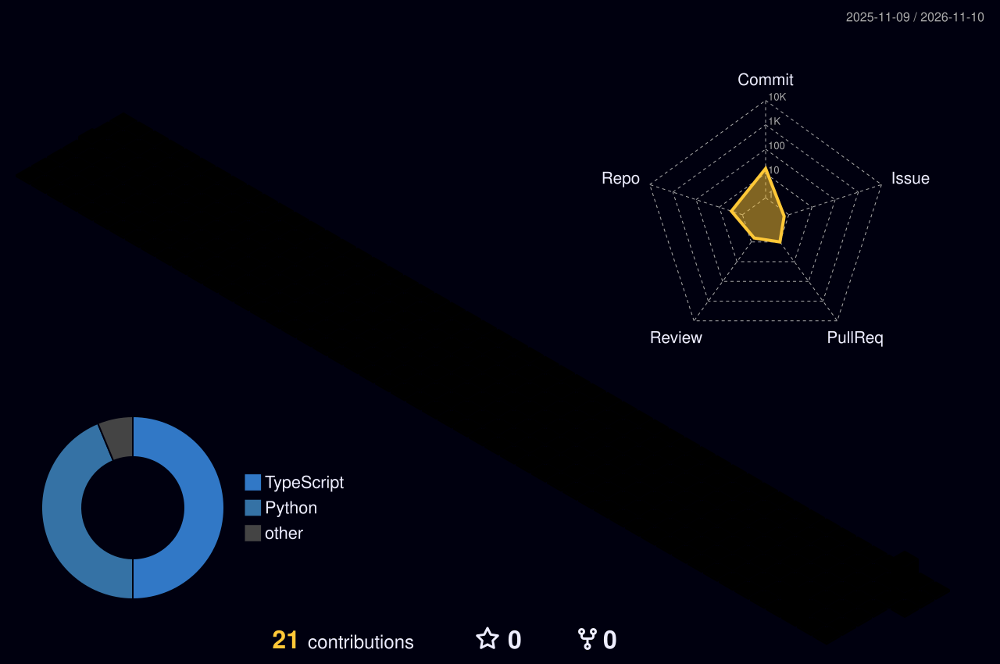

<!-- Header -->
<p align="center">
  
</p>

<p align="center">
  <a href="https://git.io/typing-svg"></a>
</p>

<p align="center">
  <a href="https://linkedin.com/in/shrikrishna-lomate-30b81633b"></a>
  <a href="mailto:lomteshrikrishna9@gmail.com"></a>
  
</p>

---

### `> whoami`

```yaml
name:      Shrikrishna Lomate
role:      B.Tech CSE, 3rd year @ D. Y. Patil Agriculture & Technical University, Kolhapur
grad:      2028
building:  modular AI systems, OCR pipelines, REST backends
seeking:   Software Engineering / AI Engineering internship
certs:     [IT Specialist — Java (Certiport), Intro to Generative AI (AWS)]
```

### `> ls ./projects`

| Codename | What it is | Stack |
|---|---|---|
| ⚡ **SHAKTI-0.1** | Independent modular AI system that runs locally | Python · Ollama |
| 🔬 **NIRIKYA** | Label & regulatory intelligence assistant (SIH 2026) | FastAPI · OCR · LLM |
| 🤖 **RACHAYTA** | AI-driven engineering, creation & physical-automation platform | Python · AI · Robotics |
| 📦 **[FlowGrid](https://github.com/Shrikrishna391/Bef-SGU-final)** | FMCG distribution intelligence: demand forecasting, safety stock, dispatch optimization (SGU-TRIWIZATHON) | FastAPI · React/TS · LightGBM · OR-Tools · Ollama |

### `> stack --list`

<p align="center">
  
</p>

### `> render --3d contributions`

<p align="center">
  
</p>

### `> stats`

<p align="center">
  
  
</p>
<p align="center">
  
</p>
<p align="center">
  
</p>

<p align="center">
  
</p>
